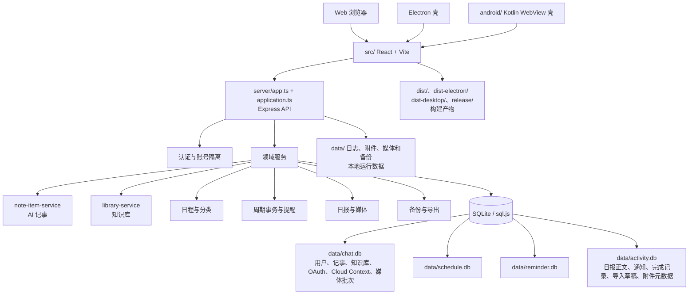

# Orbit 跨项目地图

- Status: LIVING
- Scope: 本文列明的源码结构、合同或验证方法；历史证据按时点使用。
- Source review: 2026-10-18 核对本次 Settings、共享状态、Shell 与帮助路径；其他领域按对应记录解释。版本以 package.json 为准，状态以 docs/TASKS.md 为准。
- 2026-10-08 增量：产品帮助/只读诊断为 server/product-help.ts、system-query.ts、routes/system.ts；共享 action 为 src/utils/navigation-actions.ts；运维 CLI/config/timer 位于 scripts/orbit-operations.py 与 scripts/operations，合同见 [架构](docs/ARCHITECTURE.md#产品助手与受控运行诊断)及 [部署路径](docs/DEPLOYMENT-PATHS.md#受控运维记录与保留)。
- Authority: 当前源码与自动化验证优先；文档职责见文档索引。
- Update trigger: 本领域 API、数据归属、媒体策略或验收入口变化。
- Supersedes: 原文中已纠正的漂移描述；保留历史快照时间边界。
- Do not use for: 推断当前生产部署、Work 配置或邮件收件箱状态。

本文档是 Orbit 主仓库与个人情报日报 V2 的逻辑地图。它只记录可提交的模块、边界和验证入口，不记录绝对个人路径、用户数据、令牌、授权码或运行机器上的真实配置。

## 按任务选择入口

先选一行，再按标题读取相关章节和源码。版本读 package.json，当前状态读 [TASKS](docs/TASKS.md)，历史只在追溯时查询。测试层级统一见 [测试矩阵](docs/TEST-MATRIX.md#分级执行)。

| 任务 | 先读的权威章节 | 源码入口 | 测试/升级条件 |
| --- | --- | --- | --- |
| UI、Settings、Shell、帮助页 | [UI Change Playbook](docs/UI-GUIDELINES.md#orbit-ui-统一迁移与-agent-change-playbook)、[Settings 合同](docs/ARCHITECTURE.md#settings-v3-路由与状态) | src/ui/、src/features/settings/、src/features/help/、src/layouts/SettingsFrame.tsx | Gallery 或账户/设置 Playwright；共享 token/Auth/状态变更 Full；迁移状态只看 [台账](docs/FRONTEND-DEBT.md) |
| 认证、账号、密码、权限 | [账号安全](docs/ARCHITECTURE.md#账号密码与登录失效) | server/auth.ts、routes/accounts.ts、database/queries/accounts.ts；src/hooks/useAuth.ts | account-security、http-security、persistence；共享安全变更 Full |
| 数据库、事务、备份恢复 | [持久化](docs/ARCHITECTURE.md#4-持久化) | server/database/、activity-store.ts、schedule-store.ts、reminder-store.ts、backup-service.ts | persistence/crash、phase5-migrations；必须 Full，不读取生产 data |
| 日程、无日期待办、周期提醒 | [日历数据](docs/CALENDAR-DATA-GUIDE.md)、[队列与确认](docs/ARCHITECTURE.md#orbit-对话与操作合同) | server/routes/schedules.ts、suspended-todos.ts、reminders.ts；schedule-time.ts、reminder-service.ts | schedule/unscheduled/reminder/notification 系列；跨模型或调度变更 Full |
| 知识库、经历、发布关系 | [知识库合同](docs/LIBRARY.md)、[经历](docs/LIBRARY.md#经历记忆) | server/library-service.ts、library-markdown.ts、experience-service.ts、routes/library.ts、routes/experience.ts | library/experience/search/persistence；外部本地加工项目必须显式选择工作目录 |
| 日报 Local/Cloud、媒体、V3/Research | [Cloud](docs/CHATGPT-WORK-CLOUD.md)、[排障](docs/CLOUD-DIGEST-RECOVERY.md)、[V3](docs/DAILY-DIGEST-V3-CORE-CONTRACT.md) | server/daily-report-cloud-mcp.ts、routes/reports-*.ts、digest-v2-*.ts、digest-v3-*.ts、digest-research-*.ts | daily-report/digest 系列；Local 跨项目合同才运行 test:cross-project；真实 AI/邮件另授权 |
| Android、手机推送 | [Android 构建](android/README.md)、[Push 合同](docs/ARCHITECTURE.md#android-客户端与-push) | android/app/src/、server/android-push.ts、routes/android-push.ts | android-push、通知测试及相关原生构建；FCM、本地闹钟和设备自然到达分开验 |
| 发布、构建、Tools、运维 | [发布](docs/RELEASE.md)、[部署路径](docs/DEPLOYMENT-PATHS.md) | scripts/prepare-linux-release.mjs、build-product-help.mjs、check-protected-tools.ts、orbit-operations.py | Release + 对应平台/发布包；生产执行才读取本机 DEPLOY，不自动部署 |
| 记事、图片、优化和导出 | [记事合同](docs/ARCHITECTURE.md#记事图片与草稿合同) | src/components/NoteBoard.tsx、server/note-item-service.ts、note-image-service.ts、note-prompt-optimization.ts、routes/notes.ts | note/composer-draft/prompt-optimize；合并/恢复保留事务和账号保护 |
| AI 会话、Provider、工具与草稿 | [对话合同](docs/ARCHITECTURE.md#orbit-对话与操作合同)、[Provider](docs/ARCHITECTURE.md#orbit-ai-基础升级) | server/routes/ai.ts、orbit-queue.ts、ai-plan.ts、ai-provider-*.ts、orbit-tools.ts；src/hooks/useOrbitChat.ts | orbit/provider/ai-plan 系列；确认、队列、共享身份变更 Full |
| 个人活动报告、通知连接、项目成长 | [个人报告](docs/ARCHITECTURE.md#交互连接与个人活动报告合同)、[成长数据](project-evolution/README.md) | server/activity-reports.ts、activity-events.ts、notification-chat.ts、scripts/project-evolution-lib.ts | connected-report/notification/project-evolution；个人数据不进入共享成长 JSON |
| CalDAV | [桥接合同](docs/CALDAV-BRIDGE.md)、[隔离 POC](infra/caldav-poc/README.md) | server/routes/caldav.ts、caldav-service.ts、caldav-control.ts、caldav-projection.ts、caldav-bridge.ts | caldav-api/bridge/control/lock；手机与 24h 独立验收 |
| 文档、帮助输入、历史记录 | [文档索引](docs/README.md)、[滚动维护](docs/archive/README.md#滚动维护流程) | scripts/docs-check.mjs、build-product-help.mjs、history-maintenance.mjs、verify.mjs | docs:check；帮助输入重建及权限/常见问题回归；维护脚本变更 Full |

## 1. 项目与边界

| 逻辑项目名 | 仓库范围 | 当前定位 | 允许的关系 |
| --- | --- | --- | --- |
| Orbit | `smart-schedule-agent/` | 主应用：Web、Electron、Express API、日程、提醒、账户和日报服务端 | 接收 V2 的已校验日报发布与媒体上传；按账号隔离保存 |
| 个人情报日报 V2 | `日报-v2/` | 当前日报采集、结构化生成、校验、媒体本地化和发布程序 | 通过只读/发布专用接口与 Orbit 交互；默认本地 `-NoSend` 验收 |
| `LEGACY_PROJECT` | `旧版日报/` | 只读参考与可恢复回滚边界 | 不修改代码、Prompt、配置、产物、邮件投递或定时任务 |

### 1.1 主仓库结构

前端统一重构入口：`src/design` 管语义 token，`src/ui` 管基础控件，`src/dev/UiGallery.tsx` 为仅开发的 `/dev/ui`。账户已迁入 `features/settings/account`，`layouts/SettingsFrame` 管设置页面容器，`hooks/useAuth` 的 Provider 唯一持有应用认证。其余设置已迁入 features/settings/sections；SettingsState 管共享 Cloud/通知，features/help 管只读帮助和受控问题。其他业务目录按批迁移。当前边界见 [迁移台账](docs/FRONTEND-DEBT.md)，修改入口与验证见 [Agent Change Playbook](docs/UI-GUIDELINES.md#orbit-ui-统一迁移与-agent-change-playbook)，不据目标目录推定全部迁移完成。

主应用的四个数据库文件属于运行态数据，不能从生产机器回填到仓库。`dist/`、`dist-electron/`、`dist-desktop/` 和 `release/` 是构建/打包产物；源码、测试和文档属于提交边界。

Orbit 基础升级的 Provider/能力入口是 `ai-provider-{contract,workbuddy,chatgpt}.ts`、`ai-model-capabilities.ts` 和 `routes/ai-providers.ts`；Orbit 工具由 `orbit-tools.ts` 复用现有领域服务。OAuth 助手在 `scripts/chatgpt-connect.ts`，凭据只在被忽略的加密目录。附件由 `orbit-attachments.ts` 关联会话/消息，`file-parser.ts` / `file-parser-worker.mjs` 共享有界解析，Office ZIP 预检在 `archive-validation.mjs`。前端消息、附件、设置搜索和 CSS Motion 沿用原组件。具体接口与边界只维护在 [架构](docs/ARCHITECTURE.md)。

交互连接与个人报告复用原有服务：`notification-chat.ts` 将通知队列持久投递至主对话；`activity-events.ts` / `activity-statistics.ts` 汇总可核实的执行事件；`activity-reports.ts` 保存报告、生成只读洞察和独立周报。`orbit-profile.ts` 复用账号附件保存头像，`connected-backup.ts` 纳入账号恢复。前后端共享 `src/utils/orbit-links.ts` 与 `settings-registry.ts`；网页入口仍为原统计路由。个人周报独立于情报日报，接口、未知历史与恢复边界维护在 [连接与个人报告合同](docs/ARCHITECTURE.md#交互连接与个人活动报告合同)。

CalDAV 入口为 `server/routes/caldav.ts`；`caldav-service` 共享手动/后台服务，`caldav-control` 管理自动化与备份恢复互斥，投影和账本位于 `caldav-projection`/`caldav-bridge`；周期读取全部已存实例，完成策略显式配置，派生副本按周期 ID 归并。既有任务框架增加默认未启用的5分钟桥接调度；独立服务与合成测试在 `infra/caldav-poc/`，外部进程不读主应用数据库。边界见 [CalDAV 合同](docs/CALDAV-BRIDGE.md)。

### 1.2 日报与领域模块补充

| 子领域 | 源码与唯一合同 |
| --- | --- |
| V2.5 内容/媒体/自动照片/代抓 | server/digest-v2-{contract,service,media,photos,sources,relay}.ts、digest-media-worker.ts；[Cloud](docs/CHATGPT-WORK-CLOUD.md) |
| V3 事件与冻结引用 | server/digest-v3-store.ts、digest-v3-local-flow.ts、digest-v3-offline-{extract,match}.ts、routes/digest-v3.ts；[V3](docs/DAILY-DIGEST-V3-CORE-CONTRACT.md) |
| Research/Thesis | server/digest-research-store.ts、routes/research.ts；[研究合同](docs/DAILY-DIGEST-RESEARCH-THESIS.md)，真实 Agent 自动链未接通不能据源码放行 |
| Local 采集/校验/发布 | 独立日报 V2 的 scripts/、schemas/、tests/；-NoSend 停留本地，不发布、不入队、不发信 |

Local 先本地准备并上传媒体；Cloud 由服务端按兼容/严格媒体批次合同处理，不能混用阻断规则。原文、内容质量、账号/时间、媒体/许可与真实通道均有独立验证边界；具体规则不在地图重复维护。

## 2. 跨项目 API 与安全边界

接口字段、OAuth scope、幂等与媒体规则只维护在 [Cloud 合同](docs/CHATGPT-WORK-CLOUD.md)，知识发布令牌与生命周期只维护在 [知识库合同](docs/LIBRARY.md#4-api-合同)。Local 发布复用 routes/reports-publish.ts，Cloud 复用 daily-report-cloud-mcp.ts，网页阅读复用 routes/reports-read.ts；不在地图复制第二份 API 表。

独立日报/知识库项目必须显式指定工作目录。令牌只授权绑定账号及允许接口；AI 先生成待确认草稿，不能因跨项目联动绕过正式确认。源码、本地验证、生产运行、SMTP 接受与收件箱到达分别判断。

## 3. 外部依赖与责任归属

| 依赖 | 使用位置 | 失败/授权责任 |
| --- | --- | --- |
| CodeBuddy Agent SDK / Codex CLI | 主应用 AI、V2 结构化生成 | 只处理必要的结构化输入；模型失败不能绕过确认或 Validator |
| Open-Meteo | 主应用天气与 V2 相关上下文 | 网络/地点失败必须显式表示，不伪造天气 |
| QQ IMAP | 用户 QQ 未读邮件摘要 | 单独授权码、只读摘要、按账号隔离 |
| 163 SMTP | Orbit 官方通知与回滚投递 | 仅报告传输层结果；最终到达需收件箱证据 |
| 阿里云 OSS | 可选加密备份离机保存 | 私有 Bucket、最小权限；不把备份凭据放进仓库 |
| PM2 / Nginx / HTTPS | Orbit 生产运行 | 只按 `DEPLOY.md` 的预构建、备份、原子切换和健康检查流程执行 |

## 验证与文档职责

验证方式和 Quick/Full/Release 只维护在 [测试矩阵](docs/TEST-MATRIX.md)。涉及外部项目时分别核对工作区、版本和授权，不能把本地主仓库通过视为另一项目、生产或真实投递通过。

路线顺序见 [route](route.md)，当前状态见 [TASKS](docs/TASKS.md)，版本成果见 [CHANGELOG](CHANGELOG.md)，历史证据见 [archive](docs/archive/README.md)，长期产品原则见 [PRODUCT](PRODUCT.md)。本机流水只按需读取最近记录或检索归档。
