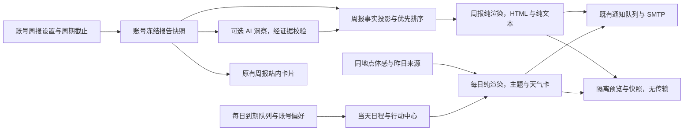
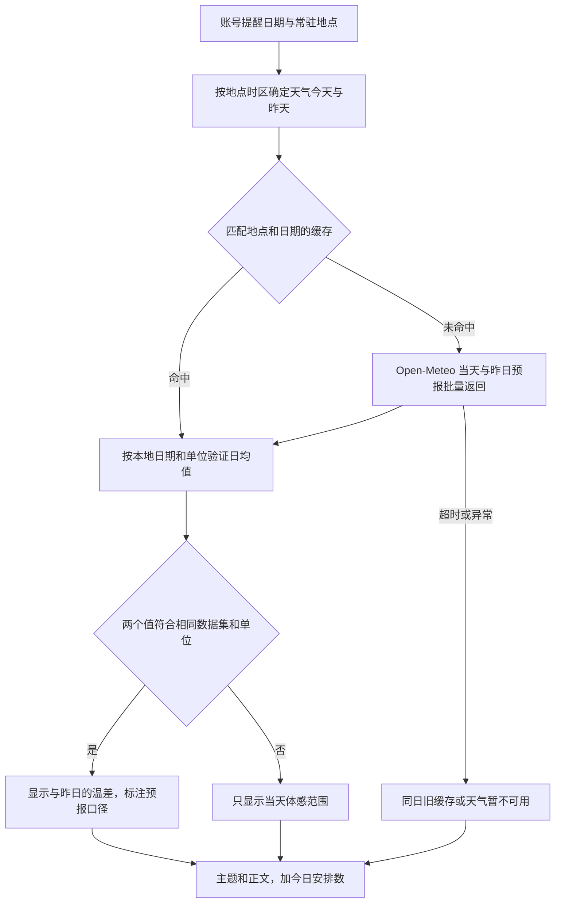
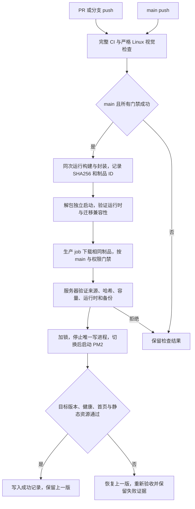
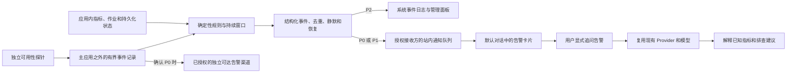
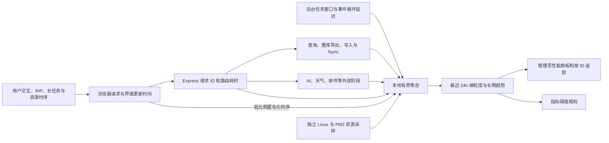

# Orbit 系统优化专项审计与实施计划

审计日期 2026-11-20，时区 Asia/Shanghai。代码基线为本地 `main` 的 `e3f10e96fc68061ef606c6f5d948b4c7fe1555b0`，应用版本 `0.69.1-261109.1944`，审计开始时工作区干净。仓库是代码和配置事实的依据。GitHub Actions 日志用于确认实际运行结果，生产只读采样用于确认现场状态，Open-Meteo 文档用于核对外部接口。以下保留原审计时点的事实。2026-11-20 用户批准第一、第二阶段的开发准备和逐项本地实施，第三阶段生产部署另行授权。复核门槛见第 0 节。

## 0. 开发准备与六项修订

1. **磁盘是生产硬闸门。** 先做只读盘点，按挂载记录活动 release、上一版、备份、暂存、候选缓存与日志占用。预算采用压缩包落地、解包空间、上传与暂存同时存在、迁移前备份及临时写、回滚材料和安全余量的峰值。已有旧版和数据算在当前已用量，避免重复计数。未知项、同挂载有效剩余量不足或保留条件未证实时，禁止上传、停写或切换。扩容与清理由用户看报告后授权。
2. **Linux 视觉是第一道 CI 门槛。** 逐一比较高级设置的 8 组新旧图，确认原入口仍存在、布局和主题变化合理。经视觉复核后重跑完整 Linux CI，以严格比较、行为测试和同 SHA 制品为验收。候选图或本地其他平台的结果保留各自证据。仓库写入、提交 push 和生产启用分别按项目授权处理。
3. **天气温差优先同数据集。** 同一次请求取同一明确数据集的今日和昨日全天平均体感，要求地点、时区、单位和统计口径一致。预报始终标注为预报。跨来源只有在可比性和来源都能确认时才可用，首版直接省略不可比较的数据，缺日或缺值时保留当天体感及原有提醒。
4. **统计型与操作型分开。** 高流量窗口用 P95/错误率与最小分母判定。低流量窗口按同一个关键操作的独立重复慢样本判定，无需等待总请求数到 30。区分用户取消、流式等待和重试，同一操作实例只计一次。两条规则合并同一事故的通知。
5. **站内告警先交付。** 先做 P1 入 AI 对话、P2 事件日志、去重和恢复，以及按事件 ID 追问。独立 P0 探针和外部应急渠道另列后续任务，主服务不可达时的站外发送交给该任务。
6. **两封原始邮件已提供。** Markdown 附件含完整 MIME 邮件和可解码 HTML。日邮件有 1 项安排、3 项逾期、2 项无固定期限；周报真实记录新增 9 项、完成 8 项。完整文本可用于回放旧版和核对新模板。历史快照未暴露的总未完成数、天气体感或昨日值继续标为缺失。原始邮件头、业务详情和可识别内容只在本地脱敏流程使用。

### 首批实施进度

| 任务 | 当前证据 | 后续门槛 |
| --- | --- | --- |
| 磁盘与 B2 准备 | 生产根盘只读报告已出，额外容量的参考下限超过可用量。新增同挂载容量检查，备份需求未知也拒绝。 | 用户决定扩容或受控清理，确定新制品和备份峰值；切换执行器、自动回滚及生产部署仍未启用。 |
| B1 视觉与 CI | 8 组截图逐张复核。上游 main 的 `e3f10e9` 在 [Linux CI 重跑](https://github.com/T1mothyS/Orbit/actions/runs/42639769155) 严格通过并上传制品。分支锁文件已改用官方 npm 下载源，新增包内启动检查。 | 新分支须在 Linux runner 完整复验；上一版结果不能覆盖新代码。 |
| A1 至 A3 邮件 | 两种邮件分支接入纯渲染器或天气扩展，真实样本脱敏回放与测试条件均有本地预览。周报用冻结数据，旧样本缺的时间或计数照实省略。 | 尚未进行真实发送与收件箱验收。 |
| A4 后端计时与 B3 站内告警 | 实现关键 API 请求关联、SQL/导出/磁盘写/同步时间、低流量与统计型 P1、事件循环 P2、去重恢复及管理员按 ID 追问。默认关闭。 | 前端与网络采集、主机时序、其他 P1 信号、长期面板与独立 P0 继续按任务交付，线上归因尚无证据。 |

## 1. 审计结论

1. **周报底座已经存在。** 周报保存可回读的统计快照，支持站内卡片和邮件队列。邮件使用通用通知模板，正文直接输出快照时间、报告 ID 和链接。现有“积压”只覆盖无日期待办，也不能直接用来表示全部未完成。优先补齐统计口径和邮件专用模板。
2. **每日邮件已有按账号读取的天气地点和失败降级。** 当前请求仅取当天气温、天气码、降雨概率和最大风速。使用现有缓存扩展当天和昨日的数据，邮件即可加入体感范围和有出处的温差。
3. **CI 有完整校验和 Linux 打包，自动部署尚未接通。** 最新 main 在安装依赖时遇到 npm 镜像 HTTP 500，后续检查和打包被跳过。上一版在 8 张 Linux 设置截图比较中失败，当前提交已更新这 8 张图，仍需严格 Linux 复验。
4. **生产容量是 CD 的前置条件。** 只读采样时根盘使用率 96%，剩余约 1.85 GiB。一次历史成功上传的压缩制品约 278 MiB，服务器还需容纳解包、回滚和备份。启用自动部署前须实测所需空间，容量不足应在停写或切换前拒绝。
5. **回环也观察到秒级等待。** 生产两轮共 15 次串行只读探针全部返回 200，其中五个请求耗时约 1.17–2.21 秒，其余约 2–5 毫秒。需要用同一关联 ID 分解浏览器、网络、后端、数据库和后台任务耗时。同步整库写是明确存在的候选原因，短采样无法归因。
6. **系统告警可复用现有通知与 AI 对话。** 已有只读系统诊断和通知入对话的持久投递，缺少结构化告警、分级规则、去重与恢复。主服务彻底不可达时，独立探针承担告警检测和第一通知，Orbit 恢复后补入对话。

## 2. 当前实现与证据

### 2.1 运行结构和数据流

- Web、Electron、Android WebView 复用 React 前端和 Express API。启动从 `server/index.ts` 经 `runtime/bootstrap.ts` 到 `application.ts`，`app.ts#createApp` 安装安全、限流、解析和 API 就绪检查。`runtime/stores.ts#createStoreInitializer` 顺序初始化四个数据库，后台任务由运行开关启动。 [项目地图](../../PROJECT-MAP.md)
- 本地源码定义 `chat.db`（账号、聊天、设置、活动快照和事件）、`schedule.db`（日程）、`reminder.db`（周期事务）、`activity.db`（完成记录、投递、日报等）。`server/database/connection.ts#initDb` 和其他三库初始化执行 schema/迁移。四库在内存中读写。 `persistence.ts#persistDatabase` 同步导出并写回，`withPersistenceTransaction` 保存撤销记录并在下次启动恢复中断事务。没有读取运行库来估算当前数据量。 [持久化合同](../ARCHITECTURE.md#4-持久化)
- `runtime/jobs.ts#createBackgroundJobs` 每分钟调度提醒，周期提醒和投递队列并行，另有备份和 CalDAV 等任务。`orbit-proactive.ts#createProactiveJobs` 每 30 秒调用主动提醒、站内投递和周报扫描。 `runtime/job-runner.ts#createJobRunner` 防止同名任务重叠，`runtime/job-status.ts` 记录任务观察状态。跨任务同时运行仍有可能。 [运行诊断合同](../ARCHITECTURE.md#产品助手与受控运行诊断)

### 2.2 邮件链路

| 入口 | 确认的调用链和合同 |
| --- | --- |
| 周报生成 | `routes/orbit.ts` 提供统计、快照、洞察和显式确认投递。`activity-reports.ts#runWeeklyReports` 按周报设置和账号时区计算截止，从 `last_cutoff` 去重。 `createActivityReport` 调用 `orbit-statistics.ts#getOrbitStatistics` 与 `activity-statistics.ts#activityStatistics`，保存账号隔离快照，模型失败时保留事实。 |
| 周报投递 | `activity-reports.ts#deliverActivityReport` 按已启用邮件或站内渠道入队，以账号、报告和渠道去重，并沿用静默时间。邮件由 `notification-service.ts#processNotificationQueue` 走 `email-service.ts#sendQueuedNotificationEmail`，对正文 HTML 转义后换行。站内由 `notification-chat.ts#deliverInApp` 使用 `activity-report-chat.ts` 转成报告卡片。 |
| 每日提醒 | `notification-scheduler.ts#enqueueDueDailyDigestNotifications` 按账号配置和本地日期生成队列项。邮件分支调用 `sendDailyReminderEmail` 读取账号偏好、当天日程和行动中心快照，再交给 `daily-email-template.ts#renderDailyReminderEmail`。站内的 `deliverDailyAction` 另外冻结卡片，并共享天气服务。 |
| 天气和缓存 | `weather-service.ts#reminderWeatherLocation` 取账号经纬度，地点时区优先于提醒时区。 `getDailyWeather` 对 Open-Meteo `/v1/forecast` 同时指定相同起止日期，读取 `daily.time[0]`。天气缓存键为四位经纬度、时区和日期，15 分钟有效，失败可回退到过期后 6 小时以内的同日缓存。地名搜索缓存 12 小时，天气与地点缓存均有上限。请求最多两次，默认单次 4 秒、总预算 8.5 秒。 |
| 发送结果 | `email-service.ts#assertEmailSendResult` 与队列处理区分 SMTP accepted、拒绝及错误，真实收件箱需要独立确认。现有优先级提醒、周期邮件、情报日报与个人周报各有业务入口。 |

初次审计的附件只有一份需求文本，里面保留了真实邮件的局部样本。邮件标题、天气行、ISO 示例可直接核对。所贴周报还有“无固定期限事项”等区块，当前 `renderActivityReport` 没有同名独立区块，且当前代码的标题分支也可能与收到的每日主题不同。现有样本不足以定位发出邮件时的版本或生成完整历史回放。 [个人活动报告合同](../ARCHITECTURE.md#交互连接与个人活动报告合同)

### 2.3 CI、制品与部署

- `.github/workflows/ci.yml` 是唯一 GitHub Actions 工作流。push、PR 都跑 Ubuntu 24.04 / Node 22.23.2 的 `verify`。顺序为安装、三份 TypeScript 检查、UI lint、成长历史、全部仓库服务测试、Web/Electron 构建、文档和生成帮助校验、Gallery 隔离、带中文字体的 Chromium Playwright。外部日报工作区测试是本地显式入口。
- main push 校验通过后，工作流复制同一 runner 的 `dist`、完整 `node_modules` 和生成帮助，使用 `scripts/prepare-linux-release.mjs` 验证 Linux x64、版本一致性、关键文件及 sharp、mammoth、exceljs、pdfjs 导入，生成清单和 tarball SHA-256。包内保留运行时当前需要的 `tsx`，它声明在 devDependencies。全量依赖因此包含所需运行依赖，也包含构建/测试依赖。清单逐文件哈希跳过 `node_modules`，完整 tarball 的校验覆盖它。缺解包后隔离首启、完整运行兼容扫描与自动交付。
- [最新 main 运行 42639769155](https://github.com/T1mothyS/Orbit/actions/runs/42639769155) 的失败发生在 `Install dependencies`。`package-lock.json` 中 1,076 个 tarball 指向 npmmirror，`zwitch@2.0.4` 的下载返回 HTTP 500，镜像报表缺失。约 18 分 39 秒后失败，后续门禁和产物步骤均跳过。没有据此判定应用代码失败。
- [前次运行 42636624704](https://github.com/T1mothyS/Orbit/actions/runs/42636624704) 的严格 UI 为 217 通过、8 失败，失败覆盖高级设置四个宽度与两种主题。(390/430) 窄屏有高度差，其余有像素差。当前 HEAD 仅更新对应 8 张 Linux 基线和来源记录，最新运行未到 UI。
- [历史成功运行 42341589040](https://github.com/T1mothyS/Orbit/actions/runs/42341589040) 日志确认 `ee1562a` 上传了 291,918,021 字节压缩制品，运行时为 Linux x64 / Node 22.23.2。相关 run 的 artifact 查询已为空，现阶段只能核对历史日志和打包源码，无法复验归档实物。源码设置保留三天。
- 现有 `deploy.sh`、`deploy-continue.sh` 属首次安装兼容入口，会在机器上安装工具或执行 `npm ci`。常规发布按 Runbook 检查哈希、备份、暂停唯一写进程、暂存并切换目录、PM2 启动和静态检查，人工执行与回滚。`scripts/orbit-operations.py#record` 可写结构化发布记录，维护与切换共用锁，可复用验收证据和保留策略。仓库没有自动上传、部署 job、生产 Environment 引用、受控启动与自动回滚执行器。 [发布流程](../RELEASE.md) · [部署路径](../DEPLOYMENT-PATHS.md)
- GitHub 元数据于审计时显示 Actions 已启用，Environment 列表为空，仓库级 Actions Secrets 数量为 0，main 的 `protected=false` 且分支规则查询为空。组织或外部密钥以及身份实际授权未核实。第 4.5 节把部署账户和 main 门禁写成启用前条件。

### 2.4 对话、系统诊断与监控

- `system-query.ts#querySystem` / `routes/system.ts#createSystemRouter` 提供状态、部署、错误、任务和提醒/日报诊断。状态读取结构化运维快照及新鲜度，全站错误需管理员。 `scripts/operations/` 给出五分钟维护 timer 和日志保留示例，当前没有细粒度资源时间序列、请求直方图或浏览器 Web Vitals 入口。
- `notification-chat.ts#deliverInApp` 写入用户默认对话的 `ai_schedule_messages`，角色为 assistant，`orbit_meta` 保存通知来源。 `orbit_notification_messages` 将投递和消息去重关联。 `chat-timeline.ts#chatTimelinePage` 和 `routes/ai.ts` 负责读历史、卡片与继续追问，`notificationContinuation` 按资源归属校验。现有 AI 选择和执行沿用 Provider/模型配置及队列，告警可以带受控上下文进入该入口。
- `src/hooks/useOrbitChat.ts#refresh` 并行发出历史、队列和会话列表请求，有流式更新和兜底定期刷新。`src/components/ActionCenterPage.tsx#loadActions` 有数据变化监听和写入后主动刷新。值得测量一轮交互中是否重复刷新。API 队列提交与模型完成已分开，AI 历史流和异步运行时间应分别统计。 [AI 及个人报告合同](../ARCHITECTURE.md)

### 2.5 当天生产只读采样

2026-11-20 20:12 中国时间起，经已有连接查看 Linux 进程和资源，以及回环 HTTP。服务器 Linux x86_64、glibc 2.39、Node v22.23.2、2 vCPU，可见内存约 1.58 GiB，采样时可用约 646 MiB。Swap 约 2 GiB，短窗口无换页。根盘剩余 1,944,088 KiB，使用率 96%。`vmstat` 的三个后续一秒窗口 I/O wait 分别为 3%、0%、3%，无持续采样可判定瓶颈。9 次请求各间隔一秒，全为 200，前三个目标各有一次明显慢响应。

| 回环请求 | TTFB / 完整耗时，逐次毫秒 |
| --- | --- |
| `/api/health` | 2207/2207、4.1/4.3、1.7/1.9 |
| `/` | 1174/1174、2.7/2.8、4.3/4.4 |
| `/today` | 2014/2014、3.0/3.2、2.9/3.1 |

20:13 做第二轮，健康耗时 1312、2.2、2.1 ms，`/today` 耗时 1651、5.2、3.0 ms，全部返回 200。两轮均为每组首个请求较慢，需要在同一目标持续串行短采样并记录建连和服务端计时，排除采样节奏与执行环境影响。第二轮看到 1 个 PM2 进程，根盘 inode 已用 55%。当前 SSH 身份无法通过默认 PM2 CLI/socket 获取具体应用的运行模式、实例或重启计数，监听进程版本也未获得。生产 PM2 模式、端到端性能和公网缓存遵循第 7 节继续核对。10 月 PVE 隔离测试曾测到公网额外等待与静态缓存收益，该记录只覆盖当时环境。 [历史性能样本](../migration/PERFORMANCE-AND-PROXY-REPORT.md)

## 3. 问题清单

优先级按实施阻塞和用户影响排列，和运行告警级别独立。

| 优先级 | 问题、位置 | 成因、影响及证据 |
| --- | --- | --- |
| 紧急 | CI 安装不稳定。`package-lock.json`、`ci.yml` Install dependencies | 写死镜像 tarball 地址，最新远程日志确认 zwitch 下载 HTTP 500，main 无新制品。 |
| 紧急 | 生产容量不足风险。`ci.yml` Prepare Linux release、`prepare-linux-release.mjs`、部署路径 A/B | 当前根盘 96%，缺新旧 release、解包峰值和备份的自动容量预算。容量采样已证实，切换所需空间待测。 |
| 高 | Linux 严格视觉门禁待验。`tests/ui/settings.spec.ts`、`tests/ui/baselines/linux-provenance.json` | 前次高级设置视觉差异已定位到 8 张图，HEAD 已更新，后续安装失败使严格比较未覆盖新图。 |
| 高 | 无 CD 及机器可执行回滚。`ci.yml`、`deploy-continue.sh`、`scripts/orbit-operations.py#record` | CI 完成于上传，CLI 只做运维记录和保留，缺同制品下载交付、事务式切换和自动回滚。代码和历史 job 均可验证。 |
| 高 | 周报正文像导出报表。`activity-reports.ts#renderActivityReport`、`email-service.ts#sendQueuedNotificationEmail` | 直接插值快照时点和 UUID，清单上限固定、顺序非重要度，内部链接直接显示。模型输出使用已知数字和对象白名单，但仍能把合法数字配给错误叙述。样本和代码支持，`aging` 的具体历史展示来源待整封样本。 |
| 高 | 周报缺独立的未完成口径及准确到期时间。`activity-statistics.ts#activityStatistics`、`getOrbitStatistics` | `backlog` 只含无日期待办，`aging` 为其中至少 7×24 小时，`metricDetails.overdue` 的 `date` 来自创建时间，报告补跑用运行时 `asOf`。现状影响数量含义和历史复盘，证据在源码。 |
| 高 | 每日天气缺体感和比较。`weather-service.ts#getDailyWeather`、`daily-email-template.ts#weatherLine/renderDailyReminderEmail`、`email-service.ts#sendDailyReminderEmail` | 只请求当天标准温度。提醒日期以提醒时区生成，天气以地点时区请求，凌晨及跨区时可能指代不同自然日。`weather_code=null` 经 Number 变 0 的路径需覆盖。 |
| 高 | 慢操作缺分层证据。`app.ts#createApp`、`persistence.ts#withPersistenceTransaction/persistDatabase`、`activity-statistics.ts`、`useOrbitChat.ts#refresh`、`ActionCenterPage.tsx#loadActions` | 同步导出、同步 fsync、重复列表/统计查询、前端刷新和网络均可计时。回环慢样本、源码路径已确认，具体瓶颈待关联测量。 |
| 高 | 告警规则及故障期通道缺失。`system-query.ts#querySystem`、`notification-chat.ts#deliverInApp`、`runtime/job-runner.ts#createJobRunner` | 有诊断读取和通知，但缺事件生命周期、跨进程存放和 AI 失败降级。主站宕机时无法渲染对话，现状影响告警时效。 |
| 中 | 监控趋势与面板缺失。`routes/system.ts`、`src/features/settings/sections/AdminSettings.tsx` | 现有状态快照粒度不足，无 P50/P95/P99、错误分母、事件循环、进程资源和可对照时间线。源码和路由盘点已确认。 |

## 4. 目标架构与实施任务

### 4.1 邮件生成流程



### 4.2 A1 周报事实与专用模板

- **修改** `server/activity-statistics.ts`、`orbit-statistics.ts`、`activity-reports.ts`、`notification-service.ts`、`email-service.ts`。**新增** `server/weekly-email-template.ts`、`server/weekly-email-template.test.ts`，扩展 `connected-report.test.ts`。`renderActivityReport` 保留为旧投递/旧快照兼容，待回归证明旧队列都能回读再下线直接拼接路径。站内报告卡和情报日报沿现有路由。
- **口径** 用账号时区的 `[start, end)` 计算周期内新增（按创建时间去重）和有效完成（按业务对象或周期实例去重，重开无有效完成的剔除）。从快照 `asOf` 的当前记录计算开放日程、待办及当前有效周期实例，排除投影副本和已完成/取消/停用对象。逾期是开放事项的子集，计时事项按现有到期字段语义，全日按业务时区跨日，周期按实例计划/到期日及任务时区。保留 `aging` 原历史口径并显示“已积压至少 7 天的无日期待办”，避免与所有未完成相加。延迟生成需明确显示实际快照时间。老快照缺失新增口径时显示“未记录”或隐藏，禁止拿当前库补写旧报告。
- **内容** 五块为本周概览、重要进展、待处理、下周安排、AI 协作。按重要级别、到期紧迫性、有效完成/改期排序，同对象跨清单避重复，次要内容折叠为有意义的计数与“查看完整报告”。每块通常最多 3 条。下周期为 `[end, 本地日历 +7 天)`，按日期分组。只在业务字段有准备动作、标签或明确时间时提示准备。改期以已记录事件为准，缺旧值时只说发生改期。读/引/记事等有价值数据作为观察或报告详情入口，缺覆盖不要写成零。
- **格式与 AI** 保持现有周报身份和冻结引用，日期使用现有时区工具及 `Intl.DateTimeFormat`，全天项保留其本地日历日期。HTML 使用站内白名单相对路径生成按钮，纯文本使用链接标签和必要的尾部可点击入口，正文无 UUID、原始时间戳或内部状态。处理标题与 URL 转义，禁第三方追踪。对已知事实先生成确定性要点。AI 只能选择经验证的事实引用与受控叙述，计数、方向与动作由程序渲染。无可核对洞察时正文照常，禁把记录数解释成工时、把工具成功解释成任务完成。周报模型调用异步有界，超时不延误事实版入队，补生成可回读且禁止自动重寄。
- **队列兼容** `processNotificationQueue` 对 `kind=weekly_report` 且 `sourceType=activity_report` 以 `userId+sourceId` 查询冻结快照，再调周报分支；老通知没有可读快照时沿用已冻结 body 或按现有失效策略终止。保持去重键、静默时间、领取/重试和收件人规则。保留既有周期时刻，非周一至周日周期如实显示覆盖区间。
- **测试与验收** 两账号、相同对象不同实例、重开、停用、跨日及恰好到边界、逾期/积压重叠、部分跟踪、同批重试、历史无字段及 HTML 注入。冻结后变更和移除对象测试可回读语义。按两份内容样本与窄屏检查层级，测试文本和 HTML 两部分，确保模型失败和预览无 SMTP。改动前置为字段样本映射及 A3 预览，使用第 6 节口径验收。

### 4.3 A2 每日体感温度与温差



- **修改** `server/weather-service.ts#getDailyWeather/reminderWeatherLocation`、`daily-email-template.ts#weatherLine/renderDailyReminderEmail`、`email-service.ts#sendDailyReminderEmail`，扩展三个对应 `*.test.ts`。**新增** 小型纯函数放在现有服务/模板，首批无需新文件、依赖或 DB schema。保留聊天、站内每日行动调用和严重天气主题前缀，后者继续抑制陈旧缓存预警。
- **协议** 保持 `DailyWeather` 现用字段，扩展体感 min/max/mean、比较值和来源。请求 `apparent_temperature_min/max/mean`、`temperature_unit=celsius`。每日邮件调用可选比较模式，在同一次 Forecast 请求拿今天和昨天，以 `daily.time` 找索引并验证有限数值、单位和日期轴，缺字段为 null。`DailyWeather.source` 仍表达缓存用于展示，另加比较口径字段。按账号提醒时区计算日程/计数，按站点 IANA 时区计算天气日历和昨日。通过队列保存的业务日期和调度时间确定天气日，重试不随执行瞬间跨日漂移，时区日期不同则天气卡明确标日期。复用 `orbit-time.ts` 的日历加减能力，禁止用固定 24 小时计算“昨天”。
- **昨日来源** 使用一次 Forecast 查询中两个本地日、同一个明确数据集的全天体感均值。仅以请求参数指定同一模型且日期、气象单位、数值范围符合条件的响应计算。正文与主题标明“预报口径”。超时、不可靠数据或两个日值缺失任一项时省略温差。后续若验证跨数据集可比性且清楚标注，才引入其他来源。 [Open-Meteo Forecast](https://open-meteo.com/en/docs) · [Historical Weather](https://open-meteo.com/en/docs/historical-weather-api)
- **展示** 以今日 mean 减昨日 mean，取绝对值四舍五入到整数，舍入为 0 时写“较昨日基本持平”，防止负零和半度正反不一致。范围 min/max 不齐时省略该段。标题按日期星期、体感范围、温差、待处理安排数量输出，仍区分无安排、全完成和积压。正文继续显示真实气温、天气状况、降雨概率、日程、逾期及无日期待办。手机主题长度用实物预览检查，把细节留在正文。
- **验收** 第 6 节天气表逐项覆盖。模拟同坐标并发命中合并、跨账号不同坐标隔离、缓存过期或不匹配日期、陈旧缓存与严重预警、非摄氏度或 null、迟重试、DST 与缺气象数据。确认有无天气都完成队列邮件分支且测试传输进入 stub。

### 4.4 A3 无发送预览

- **新增** `scripts/preview-orbit-mail.ts` 和对应测试夹具，输入版本化纯渲染数据，固定时钟与时区，输出用户指定临时目录内的 HTML/文本和主题，文件权限 0600。**修改** 两类模板导出的纯函数及现有测试入口，避免预览模块导入运行时 bootstrap、DB、SMTP、账号或定时任务。 HTML 预览禁外部资源，无写报告、入队或发信入口。
- **真实样本** 两封用户提供的原始邮件离线解码。保留原版结构与事实的脱敏回放放在被忽略的本机目录，提交只存合成夹具。周报原邮件回放验证版式，统计新字段和天气缺失事实另以合成夹具验证。
- **验收** 一次真实快照（材料齐备时）、一次含所有重点状态的合成周报和六个天气情景，断言快照确定性、零数据库写、零模型调用和零 SMTP 网络行为。保留一次窄屏（约 390px）和桌面 HTML 渲染检查，样例截图不混入现有 Linux 批准基线。

### 4.5 B1 CI 恢复与同一制品，B2 自动部署



**B1 修复依赖与制品门禁**

- **修改** `package-lock.json`、`.github/workflows/ci.yml`、`scripts/prepare-linux-release.mjs`。**新增** `scripts/verify-linux-release.mjs` 及归档验证用例。只对确认 npm 官方存在且 SRI 一致的镜像 tarball 逐项转换地址，保留版本、`integrity`、依赖树与平台可选声明。先用 runner 的 npm 做干净安装和一次空缓存检查。镜像失效修复后完整严格跑 UI，核对新 8 张基线，继续保持比较阈值和候选失败状态。验证超时测实际耗时后再调，避免无限重试隐藏镜像错误。
- 在同一 job 内用已通过检查的 checkout、`dist` 和依赖树封包。增加解包后校验清单、tar 包条目和 SHA-256，非工作区启动回环服务（临时四库、无生产变量、关闭定时、模型和发信 stub），检查 readiness、首页、`/today`、实际 JS/CSS MIME、受保护工具可见性和常用 API。启动测试读取归档内容；之后上传同一 tarball。清单记录版本、commit、Node、架构、锁文件哈希、迁移类别、归档内容大小，用于容量预检。校验归档不含配置、运行数据、私有文档、越界路径或越界符号链接。
- 首批保留已验证的完整 Linux `node_modules`。想缩包时独立把 `tsx` 明确迁入运行依赖并建立运行清单，再在 runner 生成等价生产树，以完整解包冒烟和原生模块测试证明可剔除哪些开发依赖。直接 `npm prune --omit=dev` 会影响当前入口。目标平台先与生产实测的 Node、架构、glibc、原生库对齐。
- **验收** main 同 SHA CI 全绿并有当前 artifact，PR/失败 run 无生产产物交付。记录 Action artifact ID、run ID/attempt、head SHA、包哈希、实际解包大小与冒烟结果。制品内容和清单错误必须失败。先解决 B1，再开发 B2 的自动生产触发。

**B2 同次运行部署，切换与回滚**

- **修改** `.github/workflows/ci.yml`、`scripts/orbit-operations.py` 的锁/记录集成、`docs/DEPLOYMENT-PATHS.md` 和 `docs/RELEASE.md`。**新增** `scripts/operations/orbit-deploy-release.sh`、`scripts/operations/ecosystem.config.cjs.example`、部署隔离测试。旧 `deploy.sh` 和 `deploy-continue.sh` 明确限于首次安装，普通发布统一调用同一执行器。新增/调整具体健康入口时修改 `server/application.ts` 与 `server/persistence.ts`。
- **工作流选择** 在同一 workflow 中分 verify/pack 与 deploy job，deploy 通过 `needs` 及 main push 条件取得同 run 的不可变 artifact ID 和包 SHA，按 ID 精确下载。保持 build job 无部署凭据，deploy 落在 `production` Environment，凭据只在该 job 注入。独立 CD workflow 可隔离权限，但 `workflow_run` 还要显式校验触发仓库、工作流、event、分支、成功 run、attempt、head SHA 和制品 ID，且不能信任 PR 制品。首批采用同次运行，额外隔离通过 job、Environment 和服务器账户。 [GitHub Actions 制品](https://docs.github.com/en/actions/tutorials/store-and-share-data)
- **权限与并发** 保护 main，要求严格 verify 通过和审阅部署工作流；生产 Environment 限 main，启用前核对实际权限。独立最小权限部署账户只可上传到受控 inbox、执行 root 所有的固定发布命令、访问必要运行与结果目录。固定 SSH 主机公钥，密钥留 Environment，部署 job 不执行来自 PR 的任意脚本。工作流 production concurrency 禁止取消运行中的切换，服务器 `flock` 与现有维护锁衔接；入锁后对照最新合格 main 与已部署序号，拒绝迟到的旧 artifact。连续合并可能被 GitHub 合并掉等待中的 invocation，记录“以最新通过为准”，手动回滚用专门入口。保留手动部署已验证 commit/run/artifact 和手动回滚，接入同一校验与审计。 [GitHub Actions 并发控制](https://docs.github.com/en/actions/how-tos/write-workflows/choose-when-workflows-run/control-workflow-concurrency)
- **服务器事务** 制品先进入 release 外的 inbox，核对可信的包哈希、commit、版本、平台、归档条目及依赖清单，核对有效空间（压缩包、暂存解压、备份、旧版和安全余量）、inode、内存和运行进程。生产只接收与解包验证过的制品。以版本/SHA 目录保存不可变代码与依赖，若现网尚为目录改名切换，先在隔离演练中迁移到同文件系统 `current` 原子指针。配置、绝对 `DATA_DIR`、附件和运行状态放在稳定路径，由应用身份管理。应用暂停、确认唯一写进程退出，再用现有备份机制验证恢复点。切换时记录上下游操作及前一版本，PM2 从新路径启动/重启并保存。ready check 区分进程活着、数据可用以及目标版本已加载。保留现有 /api/health 合同，新增无敏感明细的 readiness/部署版本信号，至少核对持久化阻断状态并执行轻量只读探针。首页、`/today` 和页面实际入口 JS/CSS 验证类型、长度及哈希，确认未返回 SPA HTML 假成功。
- **失败归宿** 用 durable 运行记录保存阶段和回滚目标，明确“验证前、已停旧进程、已切换、已启动、已提交”状态，超时/中断后重新进入可识别。失败停新、恢复旧指针/进程并跑同级检查，写 `rolled_back` 或 `rollback_failed`，保留旧 release、失败包和日志。恢复失败通知外部运维。清理由已有审核后的保留策略完成。容量不足、备份失败、哈希不符时在停写前退出。
- **迁移策略** 当前各 store 启动会执行迁移，`/api/health` 不等于旧版可读。每个 release 必须显式申报 `none/compatible/manual`，未知变化默认拦截；对 schema/迁移/初始化及数据映射变更，runner 用隔离副本做旧 → 新 → 旧读写和恢复测试。允许兼容加法迁移进自动通道。不可逆、变更语义、未知回滚能力时用人工批准的迁移窗口和独立恢复演练。兼容回滚沿用当前持久化新写入；非兼容恢复涉及用户新写入损失，必须先停写说明影响并取得授权。禁止自动用旧库覆盖新写入。
- **验收** 沙箱故障注入逐条覆盖错误 SHA、压缩包掉链、原生 ABI 错误、空间不足、备份错误、预检通过后断电、PM2 启动失败、health 版本不符、静态被 SPA fallback 接管、回滚失败、并发部署及维护竞争。验收返回精确失败阶段且旧版复原可用。单一 sql.js 写进程意味着短暂停服，禁止以 PM2 reload 命令宣称零停机。首发只在获批窗口执行，同时验证手动回滚。

### 4.6 B3 结构化告警进入 AI 对话

站内 P1/P2、去重、恢复与按 ID 解释为首批。下图中的独立 P0 路径是后续任务，完成普通站内告警无需等待外部探针。



- **新增** `server/system-events.ts`（事件合同、阈值、生命周期）、`scripts/operations/orbit-health-probe.*`（独立探针及示例调度）、`server/system-events.test.ts`。**修改** `server/runtime/job-runner.ts`、`runtime/job-status.ts`、`runtime/jobs.ts`、`notification-service.ts`、`notification-chat.ts`、`system-query.ts`、`routes/system.ts`、`routes/ai.ts` 及 `src/components/OrbitNotificationCard.tsx`。由 A4 供性能事件，B2 提供发布失败信号。复用已有只读状态和通知机制，保留旧通知及手动诊断。
- **事件合同** `eventId, fingerprint, state, severity, source, ruleVersion, firstSeenAt, lastSeenAt, observedAt, recoveredAt, metrics, threshold, sampleCount, correlationId, scope`。metric 名称、单位、路由模板、错误码由白名单生成，指标可为空且附缺失标志。`runtime/jobs.ts` 有捕获子任务错误后只写日志的分支，`runWeeklyReports` 会吞掉单账号异常继续处理。先补明确的成功、部分失败、失败和禁用结果，避免把运行函数返回误记为业务成功。绝不把原始日志、请求路径参数/正文、用户输入、SMTP 邮件地址、令牌、完整堆栈或者外部错误文本传入事件、对话或模型。
- **规则起点** P0 独立探针每 30 秒只读检查，连续三次失败或关键持久化故障确认后立即上报，第二观察点或存活/就绪分离用于区分公网故障、单点网络和应用故障。P1 为 API P95 超 1.5 s 且每 5 分钟至少 30 非流式请求，连续两个窗口，。另设关键操作重复超时或过慢规则，以同一操作在 10 分钟内至少 3 个独立慢样本作为低流量起点，按操作分组，重复关联 ID 只计一次。两类性能告警共享去重与恢复策略。其他 P1 包括同账号 SMTP 独立投递连续三次失败、应运行作业连续缺两个计划窗口、AI 连续超时/鉴权失败、持续持久化异常。重试同一通知不计多个独立失败。业务禁用、业务空队列、演练故障、维护窗口和低样本分开。关注 CPU/内存/Swap/磁盘的短期资源事件先按 P2 入面板。阈值在观察期验证后冻结，资源耗尽将导致不可用时按明确升级规则处理。
- **投递** 规则状态以 `scope+source+rule+目标` 为指纹，事件打开、升级和恢复分别使用幂等键，同一告警默认静默 30 分钟，维护期保留事件并记录抑制原因。达到连续健康窗口后只发一次恢复，乱序/重复只读事件不能重开旧事故。先把事件状态与待投递写在 release 外独立有界日志/小状态文件，再用既有 `notification_deliveries` 和 `orbit_notification_messages` 幂等链接对话。四个业务库不可用时保留待投递，恢复后重放并写实际发生时间。应用进程外探针必须覆盖主服务宕机，若需全主机断电/DNS 故障通知则从另一台机器探测，使用独立许可渠道。Orbit 恢复后补写告警和恢复状态，不能让两条消息被轮询乱序。
- **权限与 AI** 全站告警只发到显式配置、仍有效的管理员账号，站内复用现有投递偏好，和普通提醒的静默分别管理。用户级故障默认由管理员看到脱敏聚合，用户只可看到自己的已授权通知。投递与读取/追问时重查角色及归属，历史旧消息也不能绕过权限。规则消息用确定性模板直接到达，可由用户选择“继续分析”，服务端按事件 ID 载入脱敏指标，不使用用户传入事件正文。可选异步短解释需独立额度和超时，模型建议以文字呈现，工具限于只读诊断，禁止触发操作、写库、发信、部署、静默/变更告警。模型超时或故障仅记录结果，保留原始告警。
- **验收** 假时钟覆盖开启/去重/静默/升级/恢复/维护，中断后 outbox 重放一次。覆盖未授权、禁用账号、跨账、管理员降权、恶意内容、任务停用、P2 无聊天、故障期间 AI 不可用、主服务全停和重启补入。外部渠道在明确授权后做隔离演练，本地 stub 不发真实通知。

### 4.7 A4 性能追踪，C1 管理面板，C2 实测定位



**A4 最小可用的分层采样**

- **新增** `server/performance-metrics.ts`、`src/utils/performance-observer.ts`、`scripts/operations/orbit-resource-sample.py` 和测试夹具。**修改** `server/app.ts#createApp`、`application.ts`、`runtime/bootstrap.ts`、`runtime/job-runner.ts`、四库的 query/run 包装、`persistence.ts`、AI Provider 调用入口、`src/hooks/useOrbitChat.ts`、`src/components/ActionCenterPage.tsx` 及日历对应入口。保留业务返回值和错误、既有日志、认证和 SSE。只埋高价值路径，杜绝每个请求同步追加一行日志。
- **浏览器与网络** 登录并明确启用采样后，用 NavigationTiming、ResourceTiming、Event Timing/经验证的 Web Vitals 实现记录页面加载、INP、长任务和资源。INP 走完整页面生命周期，单次操作另记录点击到视觉反馈、首个请求出发、网络、JSON 解析和状态提交后下一帧，覆盖日程保存、待办完成、AI 提交和继续追问。DNS/TCP/TLS 在浏览器可读 Timing 与第 7 节 curl 对照中计算，连接复用或 API 不支持时标不可用。TTFB 是组合耗时。服务端耗时使用单调时钟，不用不同机器的墙钟相减。首批依赖浏览器原生能力，若 INP 回归难以维护，后续单独评估小型 web-vitals 包。
- **请求关联** 服务端生成 UUID `X-Request-ID`，使用 `AsyncLocalStorage` 关联本请求内的阶段。前端操作 ID 仅接受合法固定格式，限长度，不作为身份或任意维度。浏览器读取受控 `Server-Timing`（仅该请求的可公开缩写和模块耗时）与响应 ID，把前端采集与服务端事实做 join。Finish/close 只记一次，区分成功、超时、客户端中止及流式 SSE；AI 另记排队、首 token、总流、工具阶段和 aborted，不混入普通 API P95。路由键按方法+已匹配的模板，未知路由合并，原始 URL/查询和 account id 不进主直方图。慢样本保留受控阶段与标记，限速后才能上报。
- **后端与主机** 1 分钟直方图计算 API P50/P95/P99、5xx/超时率和对照分母，区分 SQL 执行、快照、序列化字节、写入、文件/目录 fsync、Provider 及队列耗时，分别标包含关系以免双算。 Node `monitorEventLoopDelay` 配合 utilization/GC 观测，通过后台任务名和时间窗关联。Linux 独立采样每 30 秒读取 /proc 的 CPU/内存/Swap/I/O/压力、`statvfs` 剩余量和 inode，采 PM2 在线、进程启动时间/RSS及重启增量。统计 PM2 仅取必要字段，采样身份不可读配置/业务数据。超时和权限不足报告 stale 或 unavailable。
- **采样与保留** 在内存中按分钟有限桶聚合，单独保存 1% 成功追踪与限速慢/失败样本。定时批量异步写到 release 外、权限受限的监控专用文件，不使用四个业务库。初始上限 8 MiB 内存和 64 MiB 磁盘，细粒度最多 24 小时，小时聚合最多 30 天，先用隔离负载验证实际容量。达到空间/条数上限自动降采样、轮替仅监控文件，监控盘写失败先保护业务并报告监控缺口。监控健康与业务就绪分别处理。聚合时合并直方图计数，不能平均各分钟 P95。
- **验收** 可注入的合成等待验证单次操作总耗时约 2 s 时能指出数据库、外部 AI、网络假延迟或浏览器的约 1.8 s 来源。SSE 断开/中断单计数，请求 ID 在安全边界内关联，中间件和上报失败不改变业务结果。基于隔离样本对照开关前后，同版本同负载至少三轮，初始预算新增 P95 不超过基线 5% 或 5 ms 中较大者，内存、磁盘不越界，浏览器采样不触发额外高频轮询。基线不稳定时留证据后再定阈值。

**C1 管理面板和趋势**

- **新增** `src/features/settings/sections/PerformanceSettings.tsx`、`server/routes/performance.ts` 和 Playwright 专项覆盖。**修改** `server/application.ts`、`server/system-query.ts`、`src/features/settings/sections/AdminSettings.tsx`、现有 Settings 路由和注册表。读取复用 A4 采样层，权限沿用 `authenticate + requireAdmin`，上报端点独立限流、来自已登录用户且只接受字段白名单、压缩限长和固定命名。管理查询按 5m/1h/24h/30d 和白名单路由返回定长桶。Trace 仅允许有限窗口内的关联 ID 查询，所有 API 响应 `no-store`。
- 展示四层关键趋势、量级/分母、最后采样时间、失败/采样缺失、关键阶段和事件时间线。手工或适度刷新，页面在后台暂停。面板与周报使用各自的持久数据口径。周报与系统事件联动仅在明确授权的管理员报告中提供一条真实、必要的异常摘要，使用经权限核验的链接，个人周报默认省略全站异常。
- **验收** 管理员可用，普通账号/过期或禁用账号拒绝，慢操作可按关联 ID 查到瓶颈，未知样本、IO 失败或低计数显示足够信息。按四尺寸明暗、键盘、错误和空状态执行批准视觉流程。停采集开关后现有运行状态、报告和通知稳定。

**C2 查因、消减及回归**

- **修改范围由观测决定。** 前端重复请求证实则合并 `useOrbitChat` 的同交互刷新或 `ActionCenterPage` 的重载并保留变更同步、竞态保护与错误恢复。SQL 扫描证实才用合成库做 `EXPLAIN QUERY PLAN`、限定时间窗查询和索引审查。同步事务占时证实才小步合并重复事务/整库导出，保持原子性和 crash 回归。后台错峰以任务状态和重叠证据为前提，保持防重入、补跑/漏跑及用户时区。产物 MIME/缓存取证后才调整代理缓存，带内容哈希的公开静态资产是唯一长期缓存候选。
- **验收** 至少复现一次用户可感知停顿并定位主要层级，保留同源同网络的调整前后瀑布和关联 ID。补齐 P0/P1/P2 观察与恢复验证。真实生产只做顺序低负载读与观察，代表性负载和合成数据增长测试留在隔离环境。若未复现或证据冲突，报告无法归因，保留各切片供对照，延长观察窗口。

## 5. 工作量、顺序与门禁

人日为开发、测试和文档合计估计，人工审核等待单列。各项在本计划批准后才进入工程实现。

| 阶段 / 任务 | 优先级 | 估计 | 前置 | 完成定义 | 额外审批 |
| --- | --- | --- | --- | --- | --- |
| A3 无发送预览 | 高 | 0.5–1 人日 | 现有模板和已收到的两封原件 | 可隔离生成主题/HTML/text 且零 SMTP | 真实发信单独授权 |
| A1 周报事实和模板 | 高 | 2–3 人日 | A3、字段与语义对照 | 口径、可读性、旧快照、去重、模型失败回归通过 | 真实发信单独授权 |
| A2 体感与昨日比较 | 高 | 1.5–2.5 人日 | A3、核验 Open-Meteo 返回和日期语义 | 六个天气场景、缓存/提醒降级通过 | 真实发信单独授权 |
| A4 轻量采样与复测 | 高 | 3–5 人日 | 明确关键交互；先隔离验证 | 分层计时、主机采样、样本预算和归因对照可用 | 生产启用采样获得批准 |
| B1 CI 恢复与封包冒烟 | 紧急 | 1.5–2.5 人日 | 镜像错误证据、现有基线 | 严格 Linux CI 同 SHA 通过且能解包启动 | 远程 push 单独授权 |
| B2 CD 与回滚 | 紧急前置 / 实施高 | 3–5 人日 | B1、容量预算、现网进程模式、备份恢复演练 | 同制品部署，守护锁与自动/手动回滚通过故障注入 | 生产权限、容量处置和首次启用 |
| B3 系统事件与入对话 | 高 | 3–5 人日 | 既有队列、A4 数据、独立探针及接收范围 | 假时钟规则、角色隔离、宕机补投与模型失败全部通过 | P0 外部探针/通道及管理员名单 |
| C1 面板与长期趋势 | 中 | 2–3.5 人日 | A4、B3 事件合同 | 四层趋势、关联 ID、角色、四尺寸明暗通过 | 新视觉按现有审核流程 |
| C2 渐进上线与真实排查 | 高 | 2–4 人日，加 7–14 天观察窗口 | B2/B3/A4/C1，按关卡放量 | 归因证据、24h 稳态、7–14 天趋势和恢复记录 | 生产部署及外部验收 |

建议先做 B1 以恢复 CI，同时实施 A3 → A1/A2；A4 先做隔离时间切片和真实复测，再按证据做 C2。B2 先演练，容量预检、权限、回滚达到要求后再开自动生产。B3 可先用 mock 指标落地状态机，A4 稳定后接性能规则，最后交付 C1 和持续观察。总计约 19–32 人日，预留等待审批、真机及网络对照窗口。

## 6. 测试、样例与交付验收

### 6.1 本次实际验证

- 本地 Node v26.13.0、npm 11.20.0，TypeScript 三目标检查通过。选跑 `weather-service`、`daily-email-template`、`email-service`、`notification-scheduler`、`notification-service`、`connected-report`、`persistence`、`persistence-crash`、`system-assistant`，68 项全部通过。第一次为 67 通过、1 失败，运维测试将 macOS 临时目录路径里的符号链接按安全规则拒绝。将同一临时目录解析成规范路径后完整重跑，68 项通过。基线和断言保持原样。
- `npm run docs:check` 通过。使用仓库 Mermaid 与 Chromium 解析并渲染五张图，诊断示例 Shell 代码通过 `bash -n`。
- 核对了实际 GitHub run 步骤和历史 artifact 日志，以及生产回环和资源短采样。此次未重跑 GitHub CI、未运行完整 Linux Playwright、未取得过期制品、未读取生产数据库或配置、未调用真实模型、未发真实邮件。完整生产浏览器操作、认证业务请求和公网对照留给后续现场验收。

### 6.2 合并门禁与观察

| 层级 | 命令或检查 | 放行结果 |
| --- | --- | --- |
| 邮件单元/集成 | `npm exec -- tsx --test server/{connected-report,daily-email-template,weekly-email-template,email-service,notification-scheduler,notification-service,weather-service}.test.ts`（模板测试新增后） | fixture 双格式快照，无敏感字段，空/旧报告、模板注入、队列重试、合成 SMTP 及跨账号通过 |
| 自动化流程 | GitHub Linux clean install、严格 Playwright、解包启动与 artifact ID 对照 | PR 无生产权限，旧/失败/篡改包、未通过或过期 run 一律拒绝；同次 main artefact 一致 |
| 部署 / 回滚 | 隔离 Linux 上用旧/新 release、临时四库、故障注入、断点和重复部署 | 核对切换阶段、回滚健康、稳定 DATA_DIR 和旧版读写，数据恢复单独演练 |
| 系统告警 | 假时钟、假探针、进程模拟失败、Provider stub，现有 `system-assistant.test.ts` | 门槛、角色、静默、恢复、重启重放、通知去重、模型失败可回退 |
| 性能 / UI | `npm run verify:full`、发布走 `verify:release` 加 artifact 隔离和平台门禁；四尺寸明暗及可控延迟/读写负载 | 真实耗时切片、旧功能与安全不退化，预算和视觉基线通过 |
| 生产观察 | 受控首发，前 30 分钟密集查看只读健康/静态/版本，再看 24h 和 7–14 天趋势 | 无持续新增 5xx、进程重启、漏跑、重复告警和磁盘预算突破，包含至少一次实际周报周期证据或约定延长。真实邮件另授权，SMTP 和收件箱分别记录 |

### 6.3 周报预览

**真实历史邮件片段改排，按附件所给的 ISO 样例**

> **Orbit Weekly · 个人每周回顾**
>
> 附件中的时间点，按 Asia/Shanghai 展示为 **11月15日（周日）14:33**。

该时间点来自需求中的真实邮件摘录，原字段、统计周期、账号配置时区、各项计数、事项标题未提供。预览只展示可确认的格式转换。收到两份原件后，已按 A3 生成完整原文事实的脱敏回放。旧邮件未记录的总未完成数仍省略。

**合成快照邮件，假设账号时区 Asia/Shanghai**

> **Orbit Weekly · 个人每周回顾**
>
> 11月9日（周一）至11月15日（周日）
>
> **本周概览**
>
> 新增 4 项，完成 3 项。11月16日 00:00 快照时，仍有 6 项未完成，其中 2 项已逾期。
>
> **本周重要进展**
>
> 11月12日完成「提交活动预算」。11月13日新增「预约设备维护」，下周需要确认时间。「设计评审」已改到11月18日 15:00。
>
> **待处理事项**
>
> 「确认场地合同」11月13日到期，「提交活动名单」11月15日到期，均未完成。「整理旧设备清单」已有超过 7 天未安排。另有「归档活动照片」尚无固定期限。
>
> **下周安排**
>
> 11月18日（周三）15:00 设计评审。11月20日（周五）18:00 设备维护预约到期，备注要求提前备好设备编号。
>
> **AI 协作**
>
> 已确认执行「调整设计评审时间」。核对日程的工具步骤返回了冲突检查结果。
>
> [查看完整报告](https://orbit.example.invalid/project?view=statistics)

合成未完成 6 项包括上述 2 项逾期、2 项无固定期限和 2 项即将到期。测试夹具还应补上第三条完成和新增数据以验证统计与摘要互相对应。本示例描述版式，A3 实施后用真实模板自动产出 HTML 与纯文本。

**每日邮件模拟输入与期望结果**

| 情景 | 数据和边界 | 期望结果 |
| --- | --- | --- |
| 降温 | 今日体感 -2～6°C，mean 2.1，同一数据集昨日 mean 5.2，1 项 | `11-20 周五｜全天体感 -2～6°C｜较昨日降 3°C｜今日 1 项安排`，主题和正文标预报口径并保留天气与降雨 |
| 升温 | 今日 mean 7.5，昨日 Forecast mean 5.0，2 项 | `较昨日预报升 3°C`，正文来源明确 |
| 基本持平 | 今日 mean 4.4，昨日 mean 4.8 | `较昨日基本持平`，方向无符号和负零 |
| 昨日缺失 | 今日 min/max 齐全，昨日为 null、错日、错单位或数据集不可比 | 显示今日体感与安排数，省略温差 |
| API 失败 | 超时、HTTP 非 200 或无效 `daily` | 有同日可用缓存显示缓存提示，否则显示天气暂不可用。两种都继续生成/发送到 stub |
| 时区和 DST | 等效当前时刻在提醒和地点对应到不同日期，纽约 DST 春前移/秋后移，跨月/跨年与延迟队列 | 按地点日历比较相邻日期，日程仍按提醒时区；不随时钟重算已排入队列的天气日期。避免把 23/25 小时日固定当 24 小时 |

## 7. 生产性能只读复测

在获准使用的连接上顺序操作，每次请求不超过 5 秒，间隔一秒，先同一目标做少量样本，低峰和出现症状时各留一轮。下列命令只读状态，使用已知运行路径或 URL 变量。生产凭据、返回正文和含隐私的 HAR 保留在授权环境。

| 命令或工具 | 观察点 |
| --- | --- |
| `date -Is; uptime; free -m; vmstat 1 6` | 记录时间、并发压力、可用内存、实际 swap 和 I/O wait。vmstat 第一行是历史平均。 |
| `df -h "$RELEASE_DIR" "$DATA_DIR"; df -i "$RELEASE_DIR" "$DATA_DIR"` | 检查 release 与数据的独立挂载、可用空间和 inode。只查询挂载元数据，不读取数据库文件。 |
| `iostat -xz 1 5` 或 `cat /proc/pressure/{cpu,memory,io}` | 已安装时查看磁盘 await、busy 和队列，或用 Linux 压力信息定位是否有 CPU/内存/I/O 等待。 |
| `ss -ltnH 'sport = :3000'; ps -eo comm=` | 验证监听及进程类型；仅在现有 PM2 守护进程的运行身份下确认 socket 后运行 `pm2 ls --no-color`，查看 fork/cluster、实例、Uptime、重启数和内存，前后两次计算增量。 |
| 已授权浏览器 DevTools Performance/Network | 录同一用户点击，保存事件、网络时序及请求 ID。入口选日程、完成待办和聊天，生产先用导航、只读打开详情。写操作复现在隔离环境。 |
| `curl -fsSI --max-time 5 "$PUBLIC_BASE$ASSET_PATH"` | 仅以页面实际引用且带内容哈希的公开 JS/CSS 检查 `content-type`、`cache-control`、`age`、`cf-cache-status`；比较回环和公网。HTML、认证 API、受保护工具按现有访问权限核对缓存语义。 |

在服务器用回环地址、在授权客户端用正式 HTTPS 入口分别执行同一 GET。必要时对照已有授权的中间入口，禁止临时开放端口。

```bash
for sample in 1 2 3 4 5; do
  curl -sS --compressed --connect-timeout 2 --max-time 5 -o /dev/null \
    -w 'status=%{http_code} dns=%{time_namelookup} tcp=%{time_connect} tls=%{time_appconnect} ttfb=%{time_starttransfer} total=%{time_total}\n' \
    "${BASE%/}/api/health"
  sleep 1
done
```

curl 输出为累计秒数。TCP 增量为 connect 减 DNS，TLS 增量为 appconnect 减 connect。HTTP 回环没有 TLS。TTFB 还包含网络与服务端等待，单路径总耗时不足以定位。用有效请求的原始时间、样本数和错误数表示短轮；样本不足时不写 P95/P99。若回环也慢，同时对齐 Event Loop、持久化、进程与后台作业；仅公网慢时再比对 CDN/Tunnel/客户端链路。未获得 PM2 运行身份或正式路径时保留对应未验证状态。

## 8. 风险、回滚与待确认事项

| 风险 | 约束和回滚 |
| --- | --- |
| 数据兼容、sql.js 并发写 | 无共享多写进程。兼容迁移保留当前数据，旧版重读；不可逆迁移需停写单独获批并演练恢复。在新写入可能丢失时停止自动恢复。 |
| 邮件错发、额外发信、天气延迟 | 预览与验收使用 stub，保留账号开关、静默和去重。新模板与比较采用默认可关闭的独立开关，回切旧格式并避免重寄。天气预算耗尽保留邮件。 |
| CD 错版本和中途失败 | SHA/制品 ID/版本契约、生产权限与单一执行器。故障先走自动回滚，失败保留现场，按手动入口恢复。可以禁用生产 job 后继续 CI。 |
| 磁盘与内存 | 当前根盘 96%，启用前先以只读预检量化空间，超过预算拒绝。暂存/备份/运行分离，监控有界且生产不安装构建。容量处置由具备授权的运维阶段决定。 |
| 告警噪声和隐私 | 初始只记录和核对阈值，再启用 P1 对话；P0 依赖独立探针和授权通道。下调或关闭通知出站时保留事件，删除遥测只走受管保留策略，模型失败继续显示确定性信息。 |
| 性能监控反过来造成延迟 | 独立采样、限字段、限请求频次、限内存/磁盘和异步批量写；超过预算先降采样或关闭采集，现有业务照常运行。 |

需要用户决定的事项仅涉及以下权限和生产影响。

1. 生产开通前确认维护窗口、可接受短暂停写，以及选择扩容还是按已审核的保留规则释放空间。任何容量处置前先出只读清单与可恢复证据。
2. 批准 production Environment、main 门禁、最小权限部署账户及首次启用。不可逆迁移另行审批。现有密钥及网络配置由用户授权的维护窗口管理。
3. 指定 P0 独立探针的运行位置、应急接收方/通道以及默认接收告警的管理员名单。应用彻底离线时的用户通知取决于这个选择。
4. 两封完整原始邮件已收到。以脱敏本地预览验收格式，只有需回算邮件原文缺失指标时，才另取冻结快照。真实发信与收件箱验收分别授权。

实施改变行为后，同步现有 [架构合同](../ARCHITECTURE.md)、[发布](../RELEASE.md)、[部署路径](../DEPLOYMENT-PATHS.md)、[测试矩阵](../TEST-MATRIX.md)及 [任务地图](../../PROJECT-MAP.md) 中真正受影响的条目。应用版本以 package.json 为准并与 lockfile 同步。此次交付为计划和审计证据，应用行为及版本保持审计基线。
